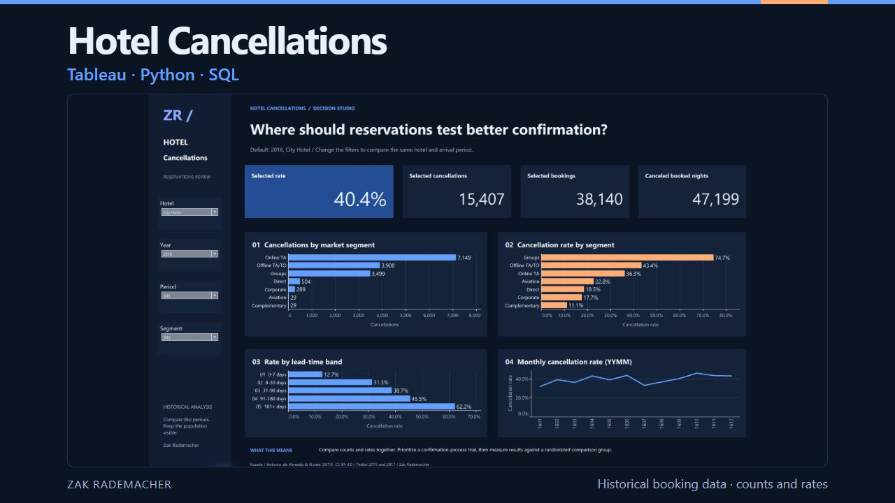
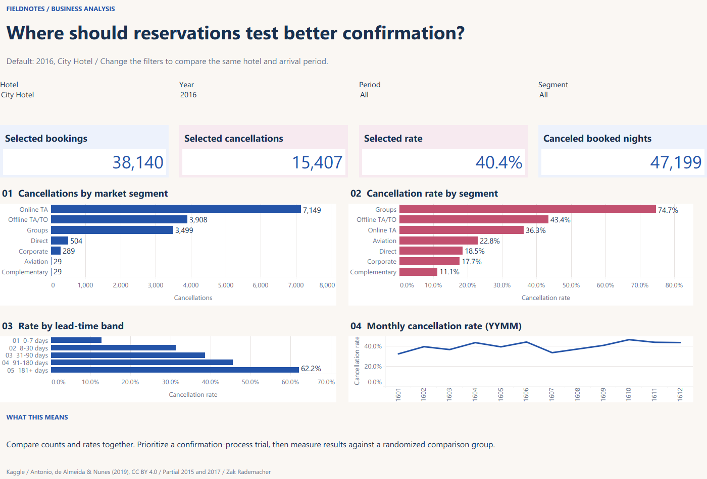

# Hotel Booking Cancellation Review



[Motion cover preview](deliverables/portfolio-motion.webm) · [Presentation maintenance guide](docs/VISUAL_DESIGN.md)

The November 2026 working-dashboard redesign adds a shared navy, blue and orange layout with clearer navigation and larger analytical panels. Calculations, source policies and report contracts are preserved. Cover motion is separate from native desktop report behavior. [Visual-release verification](docs/DASHBOARD_RELEASE.md).


**Which booking segments account for the greatest cancellation workload, and where should reservations test an improved confirmation process?**

A historical business investigation using Python, SQLite and Tableau. [Decision memo](docs/DECISION_MEMO.md) explains the evidence, next action and limitations.



The redesigned Tableau workbook and its editable source are now downloadable, matching the current working preview. [Earlier workbook layout](https://github.com/ZakJRademacher/hotel-booking-cancellation-analysis/blob/d6b6e9c23c546d840221904a12f23d5b5b98e598/deliverables/Hotel%20Cancellation%20Review.twbx) remains in repository history.

## Open the report

[Download the redesigned Tableau workbook](deliverables/Hotel%20Cancellation%20Review.twbx). Open in Tableau Desktop. Its reporting CSV is included. The first dashboard uses shared hotel, year, arrival-month and segment filters. The second dashboard explains the decision and trial. Tableau Public is not configured.

Editable source: [tableau](tableau). Run `python tools/build_report.py` to regenerate, open and save in Tableau, then run `python tools/package_report.py`. Preserve native authoring metadata in the committed workbook.

## Reproduce

Python 3.10+, standard library only:

```sh
python tools/download_data.py
python refresh.py
python -m unittest discover -s tests -v
```

The preparation writes source-row lineage, a SQLite database, reporting CSVs, comparison cells and [control totals](data/processed/controls.json). [SQL investigation](sql) shows counts and denominators explicitly. Source records are retained; repeated-looking rows without durable IDs are not automatically removed.

## Read the analysis

- [Source, version and licensing](docs/SOURCES.md)
- [Measure definitions and refresh boundaries](docs/METHOD.md)
- [Beginner walkthrough and practice](docs/LEARNING.md)
- [Verification](docs/QA.md)

Independent portfolio demonstration. Historical associations motivate a controlled follow-up experiment; they do not establish causal lift, profit or realized client outcomes. The previous Retail and Complaint projects remain available as separate supporting work.
